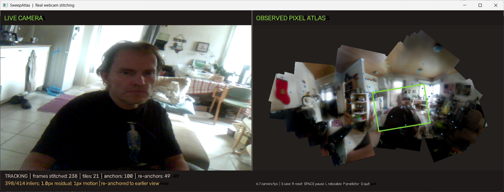

# SweepAtlas

**SweepAtlas** is a Python webcam **and video** application that stitches overlapping camera views into a larger image as you move the camera or play a recording.



The left side shows the camera/video. The right side shows the growing mosaic. Save the result as a PNG.

## Install and run

Requires Python 3.12 or 3.13, OpenCV, and NumPy. No cloud service, model download, or dedicated GPU required.

```bat
python3.13 -m pip install opencv-python numpy
python3.13 SweepAtlas.py
```

### Load a video and scrub through it

While the webcam is open, press **O** to choose an MP4/AVI/MOV/MKV/WEBM file with a file picker. The app opens its video window with a **draggable timeline** below the source frame and atlas.

Or start directly in video mode:

```bat
python3.13 SweepAtlas.py --video "C:\Videos\my_sweep.mp4"
```

Or launch the dedicated video window and choose a file:

```bat
python3.13 SweepAtlasVideo.py
```

Video playback follows the source frame rate when possible; geometry processing samples at **5 frames/second** by default (configurable with `--process-hz`). When stitching is computationally expensive playback may be slower.

**Video controls**

| Control | Action |
|---|---|
| Drag/click the timeline | Scrub to any point; pauses playback |
| **Space** | Play/pause, continue stitching from the displayed position |
| **, / .** or **Left / Right** | Step backward/forward one frame (while paused) |
| **J / K** | Jump backward/forward five seconds (while paused) |
| **O** | Open another video file |
| **S** | Save current atlas PNG |
| **R** | Reset atlas, beginning a new mosaic at the current video position |
| **L** | Try matching earlier keyframes on the next processed frame |
| **P** | Toggle camera-motion predictor |
| **Q / Esc** | Quit (auto-saves unless already saved or disabled) |

**Important:** Scrubbing is non-destructive: it changes the previewed video frame **but does not insert frames into the atlas**. Press Space to resume playback and stitching. The existing mosaic stays visible. If you jump to a distant, nonoverlapping scene, the stitcher may lose alignment; return to an overlapping region, press L to retry, or press R to make a fresh atlas at the current video position. Seeking does *not* reconstruct all frames that were skipped, and a 2D atlas cannot automatically join unrelated camera views or reconstruct a 3D room.

For perspective-changing planar sweeps:

```bat
python3.13 SweepAtlas.py --video "C:\Videos\my_sweep.mp4" --mode homography --process-hz 8
```

### Webcam controls

| Control | Action |
|---|---|
| **O** | Choose and open a video |
| **S** | Save the current mosaic |
| **Space** | Pause or resume stitching |
| **R** | Reset the mosaic |
| **L** | Search earlier views to recover alignment |
| **P** | Toggle the motion predictor |
| **Q / Esc** | Quit; auto-save if not already saved |

For a different webcam use `--camera 1`. Saved PNGs go to `sweepatlas_output/` by default; areas that were never observed are transparent. `--no-autosave` disables save-on-quit.

## How it works

SweepAtlas uses OpenCV ORB features, geometric matching and RANSAC to estimate alignment to earlier keyframes. It warps and blends *observed* source pixels into lazily allocated mosaic tiles, and keeps a simple camera-motion estimate to help choose keyframes. It can try to re-anchor the current view to a previous keyframe.

Video mode uses the **same atlas backend**, with OpenCV VideoCapture for decoding and a mouse-driven timeline for seeking.

This is **classical computer-vision stitching**, not a trained AI model, TransformerX implementation, or full SLAM system. It does not generate unseen scene content. Re-anchoring is not global bundle adjustment or 3D SLAM optimization.

## Best results, limitations and tests

Move the camera slowly, maintain good overlap, and scan a textured, mostly flat subject such as a poster, painting, painting detail, table or wall.

Sweeping around a 3D room, going around corners, passing moving people, or changing perspective strongly can introduce ghosting and misalignment. The application does not perform depth reconstruction or global map correction.

Run the original synthetic alignment check:

```bat
python3.13 SweepAtlas.py --self-test
```

Run headless video seek/read tests from the repository root:

```bat
python3.13 -m unittest discover -s tests -v
```
